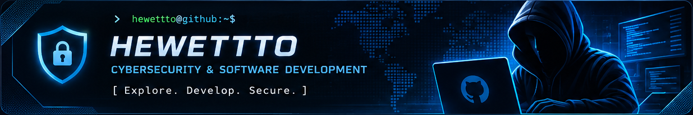

  

## About Me

I'm **Murodjon**, a cybersecurity student and software developer from Uzbekistan.

- Cybersecurity & Full Stack Development
- Secure and scalable software solutions
- Linux, AI & Network Security

---

## Tech Stack

  

---

## GitHub Statistics

  
  

---

## Featured Projects

| Project | Description |
|---|---|
| [RAVEN](https://github.com/hewettto/RAVEN) | Attack Surface Mapper for authorized security testing |
| [Attendance Bot](https://github.com/hewettto/5AX-8_davomat_bot) | Telegram attendance management system |

---

  <b>Explore. Develop. Secure.</b>

---

## Contribution Activity

  

